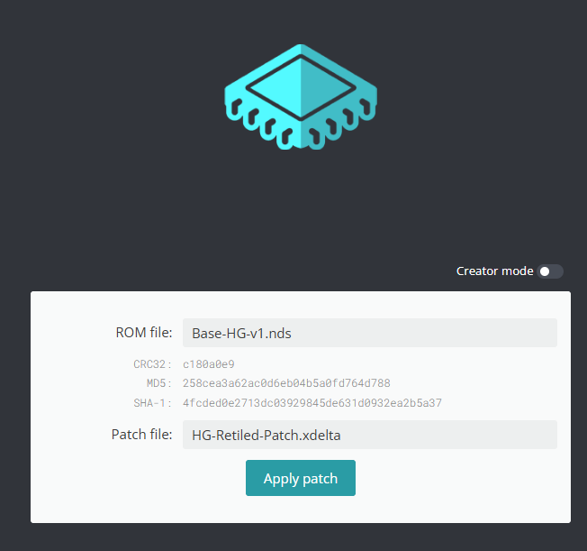

# Pokémon Heartfelt Gold

**Pokémon Heartfelt Gold** is a major update to the HeartGold Retiled project for Nintendo DS. It combines redesigned maps with reworked wild encounters and trainer parties, additional scripted static encounters, and hg-engine quality of life changes.

There are still some awkward or glitchy tiles, but the project is playable and ready for community feedback. If you try it, please share what worked, what looked odd, and where you found it.

> [!IMPORTANT]
> This repository contains patch files and mapping resources only. It does **not** contain a Nintendo DS ROM, a DSPRE project, or an extracted ROM. You must supply your own legally obtained copy of Pokémon HeartGold.

## Screenshots

<p align="center">
  
  
  
</p>

## Download and play

The current Heartfelt Gold patch is:

- [Heartfelt-Gold-v1.0.8-Patch.xdelta](https://github.com/Trinsic64/Heartfelt-Gold/releases/download/heartfelt-v1.0.8/Heartfelt-Gold-v1.0.8-Patch.xdelta) — fixes for scripted item pickups, Ruins of Alph encounters and battle sprite centering. Keeps the original overworld camera and includes the new indoor camera settings. Includes the features from earlier releases. See the [GitHub Release](https://github.com/Trinsic64/Heartfelt-Gold/releases/tag/heartfelt-v1.0.8) and [release notes](RELEASE-NOTES-HEARTFELT-v1.0.8.md).

The [v1.0.7](https://github.com/Trinsic64/Heartfelt-Gold/releases/tag/heartfelt-v1.0.7), [v1.0.6](https://github.com/Trinsic64/Heartfelt-Gold/releases/tag/heartfelt-v1.0.6), [v1.0.5](https://github.com/Trinsic64/Heartfelt-Gold/releases/tag/heartfelt-v1.0.5), [v1.0.4](https://github.com/Trinsic64/Heartfelt-Gold/releases/tag/heartfelt-v1.0.4), [v1.0.3](https://github.com/Trinsic64/Heart-Gold-Retiled/releases/tag/heartfelt-v1.0.3), [v1.0.2](https://github.com/Trinsic64/Heart-Gold-Retiled/releases/tag/heartfelt-v1.0.2), [v1.0.1](https://github.com/Trinsic64/Heart-Gold-Retiled/releases/tag/heartfelt-v1.0.1), and [v1.0.0](https://github.com/Trinsic64/Heart-Gold-Retiled/releases/tag/heartfelt-v1.0.0) patches remain available for archival use.

The v1.0.8 patch was decoded against a clean USA source matching the hashes below. Its output SHA-256 is `a342cf8fc32d81cb529e4be4d8ce7f0d89be06345f71d06ce4aa772d66cb4ca9`.

**Save import friendly:** in-game saves from earlier Heartfelt Gold versions are expected to remain compatible. A known copied save passed a load, save and reload test on v1.0.7; v1.0.8 has not had a new save/reload test. Back up your save, import or copy it for the new ROM, and continue without starting a new game. Match the save filename to the new ROM where your emulator requires it. Boot from the in-game save rather than loading an older emulator save state.

The older Retiled Expansion and visual-only patches remain available for archival use:

- [HG-Retiled-Expansion-Patch.xdelta](xDelta/HG-Retiled-Expansion-Patch.xdelta?raw=1)
- [HG-Retiled-Patch.xdelta](xDelta/HG-Retiled-Patch.xdelta?raw=1)

The [HG-Retiled-v3.bps](HG-Retiled-v3.bps?raw=1) file is included only as an optional visual-only alternative. The instructions below use an xDelta patch.

### Required source ROM

You must supply your own legally obtained, clean, unmodified **Pokémon HeartGold (USA)** ROM. Check that it matches all of these hashes before patching:

```text
MD5:     258cea3a62ac0d6eb04b5a0fd764d788
SHA-1:   4fcded0e2713dc03929845de631d0932ea2b5a37
SHA-256: 65f02a56842b75aa92d775d56d657a56fe3fa993550b04dc20704ab82d760105
```

If your hashes differ, do not force the patch. Obtain the correct clean USA revision first.

### Apply the xDelta patch

Use either:

- [xDelta UI](https://www.romhacking.net/utilities/598/) for a downloadable desktop patcher; or
- [RomPatcher.js](https://www.marcrobledo.com/RomPatcher.js/) to apply the patch in your browser.

Then:

1. Back up your clean ROM dump.
2. Open xDelta UI or RomPatcher.js.
3. Select your original Pokémon HeartGold (USA) `.nds` file as the **source/ROM file**.
4. Select `Heartfelt-Gold-v1.0.8-Patch.xdelta` as the **patch file**.
5. Apply the patch and save the newly generated `.nds` file separately from your original ROM.

Apply exactly one patch to the clean ROM. Do not stack Heartfelt Gold with any earlier Retiled patch.

In RomPatcher.js, the selections should look like this:

<p align="center">
  
</p>

### Optional BPS alternative

`HG-Retiled-v3.bps` is available for people who prefer a BPS-compatible patcher, but it is not the main patching method. Start from the same clean USA ROM listed above and apply only one patch format—not both.

## Verify the download

SHA-256:

```text
AB937CFB6E085684AE46E4DC6FBB1C1267788AEE63800F43A0346951AEF29C3A  xDelta/Heartfelt-Gold-v1.0.8-Patch.xdelta
C37541B75A3EFD0802A457EC9F36A53EED324B3CF7A49AC58888FD1D855470D0  xDelta/Heartfelt-Gold-v1.0.7-Patch.xdelta
810C69A129B4044FB13852D26332326CD38E227265E1BA126EF0425A9D3A03A1  xDelta/Heartfelt-Gold-v1.0.6-Patch.xdelta
D814036E86628E9D0512701094DC7F9AC54A11D6B3AEBC716A837F77CCF74506  xDelta/Heartfelt-Gold-v1.0.5-Patch.xdelta
19FFD05CF2E2A11B0E75697BA91AE721ED55CBE3677A61D89889AF3AC03D903B  xDelta/Heartfelt-Gold-v1.0.4-Patch.xdelta
8B8BEF11E6305ADFD47AB42DB5604A24CF20908B28284E035AE43F38C33D6575  xDelta/Heartfelt-Gold-v1.0.3-Patch.xdelta
341D63D598DDAEE8F0379E85DE548D74BD54010A5D8410D7BF038F8DF5B0C2DC  xDelta/Heartfelt-Gold-v1.0.2-Patch.xdelta
9C3054B3E1B2D8492D75262EB7F0E6C61D80A48E3A0B7E3300DCAB9438DB6020  xDelta/Heartfelt-Gold-v1.0.1-Patch.xdelta
3A7799354F4CB11E0169B9AE3E8F73BFBC334AD83A1B0D58ABB3D2260DEC4443  xDelta/Heartfelt-Gold-v1-Patch.xdelta
0B4328C30B1C41CBC9E22CBAC47A35B681F906063AC0F35B31C9A4A8487417F4  xDelta/HG-Retiled-Expansion-Patch.xdelta
33EAC6B179A5ADB2CDC4372EBE77078FB5D48D94D44464EA3ECE5F7FB91F69AF  xDelta/HG-Retiled-Patch.xdelta
15DAD7B1494C1CFD9F0F595472E20B628EE5CDA3D85CE3C6B0BBE1B1E11F51F5  HG-Retiled-v3.bps
```

On PowerShell:

```powershell
Get-FileHash .\xDelta\Heartfelt-Gold-v1.0.8-Patch.xdelta -Algorithm SHA256
Get-FileHash .\xDelta\HG-Retiled-Expansion-Patch.xdelta -Algorithm SHA256
Get-FileHash .\xDelta\HG-Retiled-Patch.xdelta -Algorithm SHA256
Get-FileHash .\HG-Retiled-v3.bps -Algorithm SHA256
```

On macOS or Linux:

```bash
sha256sum xDelta/Heartfelt-Gold-v1.0.7-Patch.xdelta xDelta/HG-Retiled-Expansion-Patch.xdelta xDelta/HG-Retiled-Patch.xdelta HG-Retiled-v3.bps
```

The map archive hashes are recorded in [checksums.sha256](checksums.sha256).

## Player guides

The [Heartfelt Gold player-guide index](Docs/Guides/README.md) links to current wild encounter, trainer, evolution, static encounter, and hg-engine feature guides. These are based on the current authoring source and the supplied static script export; the patch binary was not independently decoded against every table.


## Maps for creators

The [Maps](Maps) directory is included for people interested in mapping or studying the project. It contains the current expanded overworld and cave resources. The [Data](Data) directory contains related matrix data, and the RAR files under `Maps` are convenience snapshots.

See [MAPS.md](MAPS.md) for the contents, formats, archive checksums, and safe-use notes.

## Project status

This is a work in progress. Expect visual errors, awkward transitions, and incomplete polish in some locations.

The [next update notes](Docs/Next-Update-Notes.md) record the Cyclizar encounter additions included in v1.0.1.

When reporting a problem, please include:

- the location and nearest landmark;
- what the tile should look like;
- a screenshot if possible; and
- the patch filename or release version you used.

Please do not attach ROMs, saves containing personal information, DSPRE workspaces, or extracted game data to issues or pull requests. See [CONTRIBUTING.md](CONTRIBUTING.md) for details.

## Legal notice

This is an unofficial, non-commercial fan project. Pokémon and Pokémon HeartGold are trademarks of their respective owners. This project is not affiliated with, endorsed by, or sponsored by Nintendo, The Pokémon Company, GAME FREAK, or Creatures Inc.

No game ROM is provided. You are responsible for complying with the laws that apply to you and for using a legally obtained copy of the game. Third-party game assets remain the property of their respective owners. No general license is granted for the repository contents; see [NOTICE.md](NOTICE.md).
